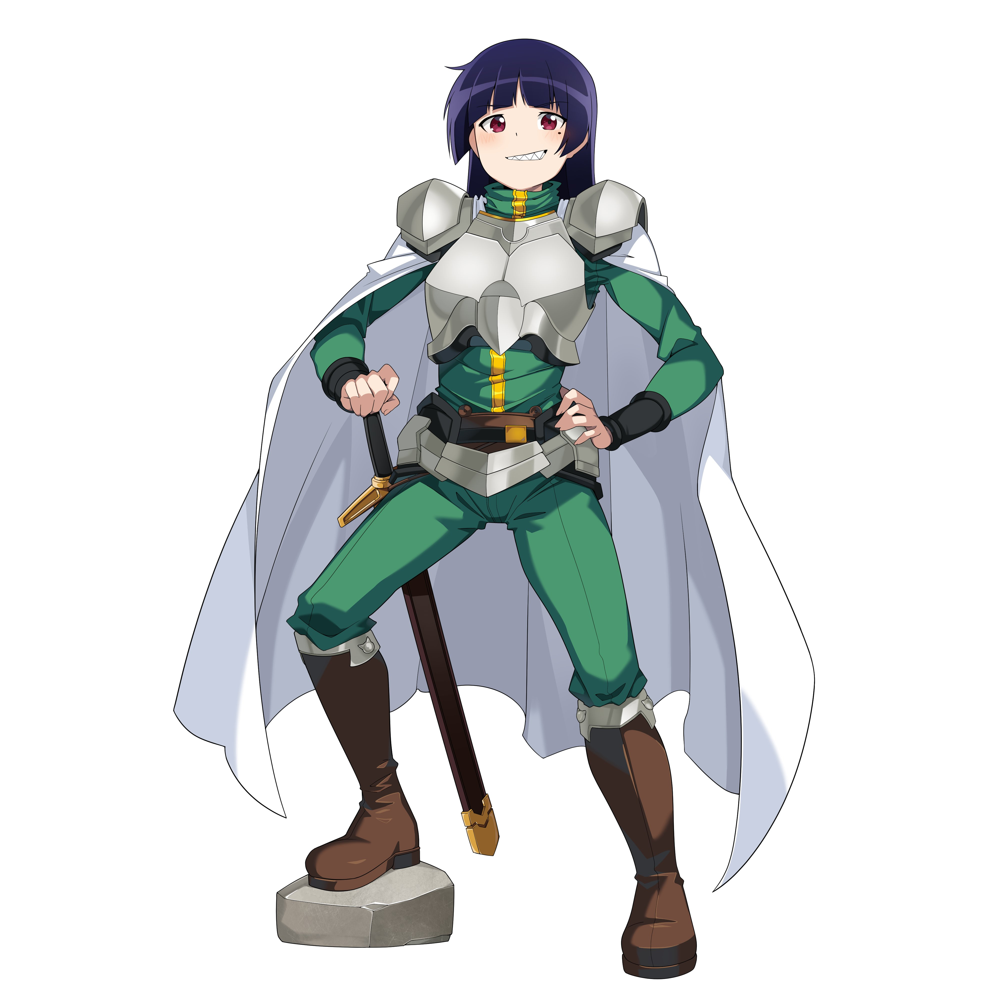

Little University project.
The goal is to present some improvements to UX and UI of some site or app, the one choosen here was 4chan, take it as a simple prototype, by the time that this is being written its basically ready but I'll put more improvements here in due time just for fun.
(There's a small chance of bugs)

